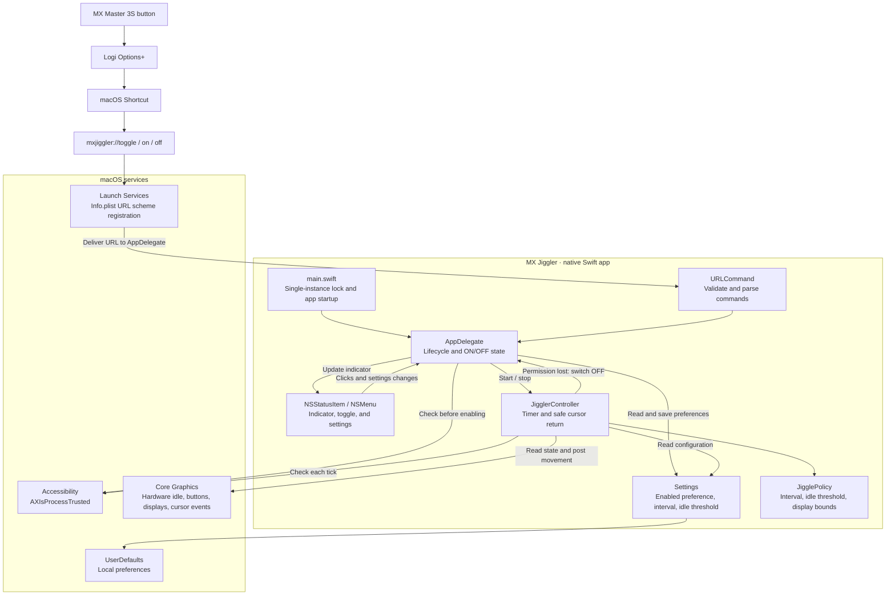

# MX Jiggler

A lightweight native macOS menu bar app that lets you control a mouse jiggler from your Logitech MX Master 3S through Logi Options+.

Launch it once, see its status in the menu bar, and toggle it from a mouse button, a macOS Shortcut, or the menu bar itself. It also works with other mice and requires no Logitech APIs.

## Contents

- [Features](#features)
- [Requirements](#requirements)
- [Build and install](#build-and-install)
- [Accessibility permission](#accessibility-permission)
- [Usage and settings](#usage-and-settings)
- [URL commands](#url-commands)
- [Logitech MX Master integration](#logitech-mx-master-integration)
- [Architecture](#architecture)
- [Development and testing](#development-and-testing)
- [Privacy](#privacy)
- [License](#license)

## Features

- Permanent mouse icon with an **ON / OFF** indicator; no Dock icon or main window.
- Left-click to toggle and right-click to open settings.
- Configurable jiggle interval and inactivity threshold, with checkmarks for selected settings.
- Small cursor movement with a return after approximately 150 ms.
- Skips movement while a mouse button is held and avoids snapping back after user activity.
- Cursor destinations stay within the current display, including displays left of or above the primary.
- Persists settings and the enabled preference using macOS `UserDefaults`.
- Accessibility permission guidance and single-instance protection.
- URL commands for macOS Shortcuts and programmable mouse buttons.
- Native Swift and AppKit, without external dependencies.

## Requirements

| Requirement | Details |
| --- | --- |
| Operating system | macOS 11 or later |
| Build tools | Xcode Command Line Tools with Swift |
| Cursor control | Accessibility permission for MX Jiggler |
| Optional mouse integration | Logitech MX Master 3S and a compatible Logi Options+ installation |

The minimum deployment target is macOS 11. The current build has been checked locally on macOS 26; older versions still need runtime testing.

## Build and install

Install the Xcode Command Line Tools if needed:

```bash
xcode-select --install
```

Clone the repository and build:

```bash
git clone git@github.com:FernandoMorais/MXJiggler.git
cd MXJiggler
./build.sh
./test.sh
```

The app is created at `dist/MX Jiggler.app`. Install and launch it:

```bash
cp -R "dist/MX Jiggler.app" /Applications/
open "/Applications/MX Jiggler.app"
```

The build targets the current machine's architecture and uses an ad hoc signature. It fails if compilation or signature verification fails. This is a local build; a notarized release is not currently provided.

To use an installed development signing certificate:

```bash
SIGNING_IDENTITY="Apple Development: Your Name (…)" ./build.sh
```

Rebuilding an ad hoc signed app may require removing and re-adding its Accessibility entry. Keep one installed copy at a consistent path: multiple copies can register the same URL scheme, making macOS choose a different copy.

## Accessibility permission

First launch starts **OFF** and does not automatically request permission. Click the menu bar item to enable it. If permission is missing, the app explains where to grant it:

**System Settings → Privacy & Security → Accessibility → MX Jiggler**

1. Enable the installed app. If it is missing, use the **+** button to add it.
2. Turn the jiggler on again from the menu bar.
3. If macOS requires a relaunch, quit and reopen the installed app.

Right-click → **Check Accessibility Permission** to check status or request the macOS permission prompt.

The enabled preference is restored at launch only if Accessibility is already granted. If permission is revoked while running, the app switches off. No notification permission is needed.

## Usage and settings

| Action | Result |
| --- | --- |
| Left-click the menu bar item | Toggle ON / OFF |
| Right-click the menu bar item | Open the settings menu |
| Select **Interval** | Choose how often a jiggle may occur |
| Select **Only Jiggle After** | Choose the inactivity threshold |
| Select **Quit MX Jiggler** | Stop and exit the app |

| Setting | Choices | Default |
| --- | --- | --- |
| Jiggle interval | 30, 45, 60, 90, 120 seconds | 60 seconds |
| Inactivity threshold | 1, 2, 4, 5 minutes, or Always | 4 minutes |
| Cursor movement | Two Quartz coordinate units, then return | Approximately 2 px; 150 ms before return |

**ON** means the jiggler is enabled and waiting for its configured inactivity threshold. With defaults, it waits until hardware inactivity reaches four minutes, then jiggles at most once every 60 seconds. Keyboard or mouse activity makes it wait again. Select **Always** for periodic movement without an inactivity threshold.

The app checks once per second. Scheduling and system sleep can delay a jiggle, and changing settings restarts the interval countdown. It does not wake a sleeping Mac, disable a lock screen, or guarantee that another application will consider you present.

## URL commands

```bash
open "mxjiggler://toggle"
open "mxjiggler://on"
open "mxjiggler://off"
```

| URL | Behavior |
| --- | --- |
| `mxjiggler://toggle` | Invert the current state |
| `mxjiggler://on` | Enable the jiggler if permission is granted |
| `mxjiggler://off` | Disable the jiggler |

`on` and `off` are idempotent. If the app is closed, macOS launches it and delivers the command. Invalid commands are ignored. Normal URL commands target the running app; a process lock prevents simultaneous copies from running. Avoid `open -n`.

The included `toggle.command` file is a convenience wrapper for the toggle URL.

## Logitech MX Master integration

1. Create a macOS Shortcut named **Toggle MX Jiggler**.
2. Add a **Run Shell Script** action containing:

   ```bash
   open "mxjiggler://toggle"
   ```

3. Run the Shortcut once and confirm that the menu bar indicator changes.
4. In Logi Options+, assign a button, such as the Gesture Button, to run the Shortcut using the actions available in your version.
5. If a direct Shortcut action is unavailable, assign a keyboard shortcut to the macOS Shortcut and map the mouse button to the same key combination.

Test the assignment in the applications where you use the mouse: per-app mappings may override the global mapping. Options+ labels and available actions vary by version; the physical button integration still needs verification on your Mac.

## Architecture

The mouse integration sends standard macOS URL commands. Inside the app, `AppDelegate` manages the menu bar and enabled state, while `JigglerController` checks inactivity and schedules cursor movement.



`JigglerController` checks once per second while enabled. A jiggle requires Accessibility permission, sufficient inactivity, an elapsed interval, and no held mouse button. The cursor returns after approximately 150 ms only if it is still at the displaced position and no recent hardware activity is detected.

The diagram uses a fenced `mermaid` block so it can render in GitHub and in a Mermaid-enabled VS Code Markdown preview. Component names match the current implementation; permission handling and menu bar logic both live in `AppDelegate`.

## Development and testing

```text
MXJiggler/
├── Sources/
│   ├── main.swift                App entry point and instance lock
│   ├── AppDelegate.swift         Menu bar, URLs, and permission guidance
│   ├── JigglerController.swift   Timer, inactivity, and cursor events
│   └── Settings.swift            Preferences and movement policy
├── Tests/
│   └── main.swift                Logic checks without Accessibility permission
├── docs/
│   └── TESTING.md                Manual validation checklist
├── Info.plist                    App metadata and URL scheme
├── build.sh                      Compile and sign the app
├── test.sh                       Run tests and validate Info.plist
└── toggle.command                Open the toggle URL
```

Run `./test.sh` for 28 assertions covering inactivity and interval boundaries, URL command validation, and cursor destinations across display arrangements. Run `./build.sh` to compile the app and verify its signature.

Inactivity uses Core Graphics hardware event state. Synthetic movement uses a private event source at the session event tap so hardware activity can be tracked separately.

Local validation has confirmed the build, signature, logic tests, hardware inactivity query, and a single running instance after repeated OFF URLs. Visual interactions, actual cursor movement, and Logitech button integration still need manual testing. See the [manual validation checklist](docs/TESTING.md).

## Privacy

MX Jiggler runs locally. It makes no network requests, sends no telemetry, and records no keyboard or mouse input. It stores preferences in `UserDefaults` and uses a local process lock. Inactivity is read as elapsed time, without recording what you typed.

## License

No license has been selected yet. This repository currently has no license granting reuse or redistribution rights.
